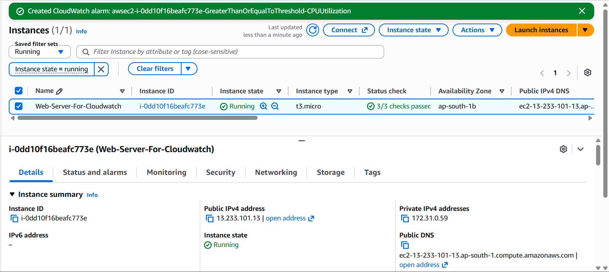
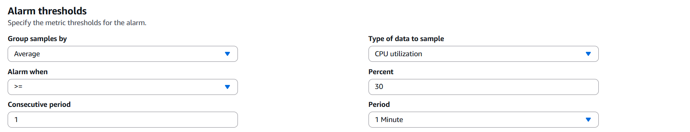
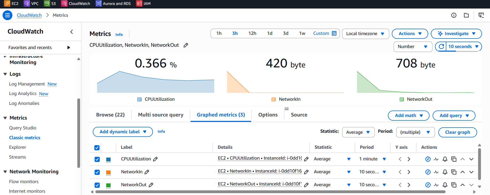
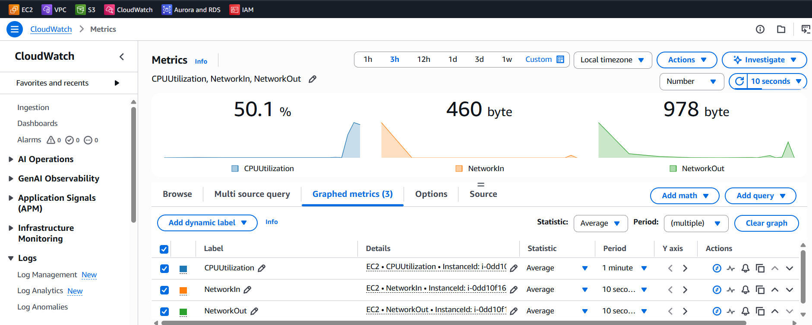
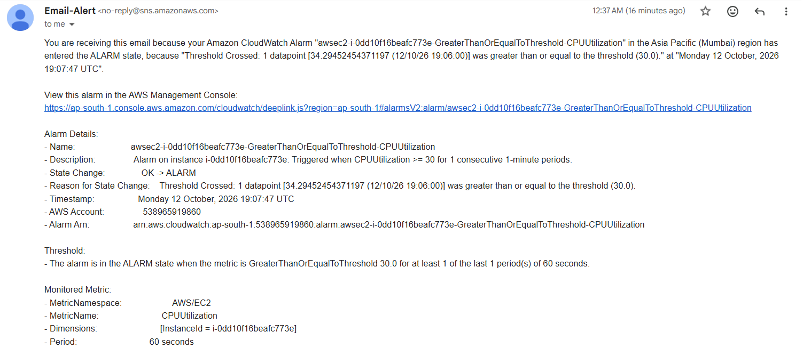

# Monitoring an EC2 Web Server with CloudWatch & SNS

## Overview
Deployed an Apache web server on AWS EC2 and configured a CloudWatch
alarm to monitor CPU usage, with automatic email alerts through SNS.

## Architecture
EC2 (Apache) → CloudWatch Metrics → CloudWatch Alarm → SNS → Email

## Services Used
- Amazon EC2
- Amazon CloudWatch
- Amazon SNS

## Steps
1. Launched a t3.micro EC2 instance (Amazon Linux) in ap-south-1 (Mumbai)
2. Used User Data to install and start Apache automatically (see `user-data.sh`)
3. Created an SNS topic and subscribed my email address
4. Created a CloudWatch alarm: Average CPUUtilization >= 30% for 1 period of 1 minute
5. Increased CPU usage on the instance and received the alert email

## Results
The alarm changed from OK to ALARM when CPU reached 34.29%,
and an email notification was received through SNS.

## Screenshots

### EC2 Instance and Alarm Created

### Alarm Thresholds

### CloudWatch Metrics (Normal Load)

### CloudWatch Metrics (CPU Spike)

### Email Alert

## What I Learned
- Bootstrapping a server with EC2 User Data
- Setting alarm thresholds and evaluation periods in CloudWatch
- Sending notifications with SNS
- Reading CPU and network metrics

## Security Note
The instance was terminated after testing. Use key-pair SSH
authentication, and never enable root login or use weak passwords.
